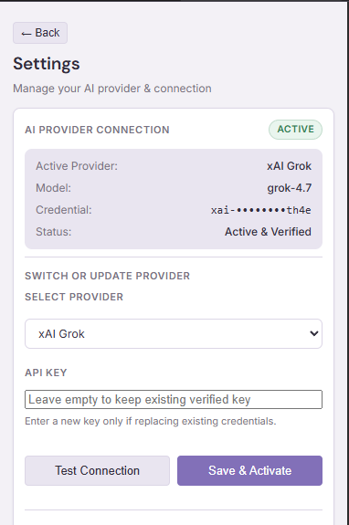
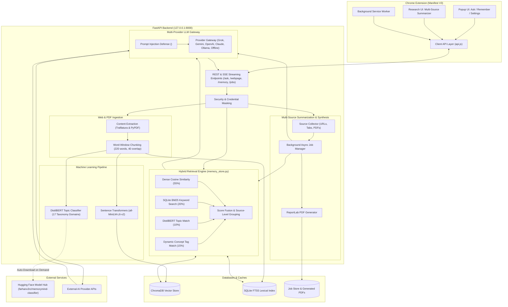

# MemoryMind ðŸ§

> **Your Personal AI Web Memory & Multi-Source Research Synthesis Platform**
> Capture knowledge from arbitrary webpages, perform hybrid semantic-lexical recall, categorize content using fine-tuned transformer topic classification, and synthesize grounded research with verifiable citations.

[](https://fastapi.tiangolo.com)
[](https://developer.chrome.com/docs/extensions/mv3/intro/)
[](https://www.trychroma.com/)
[](https://huggingface.co/farhanx3rz/memorymind-classifier)
[](LICENSE)
[](https://www.python.org/)

---

## 📸 Application Showcase

| 1. Main Interface & QA | 2. AI Provider Settings | 3. Webpage Memory Saved |
|:---:|:---:|:---:|
|  |  |  |
| Ask questions grounded in saved memories with streaming answers and citations | Transactionally configure and test Grok, Gemini, OpenAI, Claude, or Ollama with masked keys | One-click webpage capture with automatic DistilBERT topic classification and dynamic tags |

---

## âš¡ Quick Start

Get MemoryMind up and running locally in under 2 minutes:

```powershell
# 1. Clone repository & install dependencies
git clone https://github.com/farhanx3rz/MemoryMind.git
cd MemoryMind
python -m venv .venv
.\.venv\Scripts\Activate.ps1
pip install -r requirements.txt

# 2. Configure environment (Offline / Echo mode works with zero API keys!)
copy .env.example backend\.env

# 3. Start the FastAPI backend server
python backend/run_server.py
```

4. **Load the Chrome Extension:** Navigate to `chrome://extensions/`, enable **Developer mode**, click **Load unpacked**, and select the `extension/` directory.

> **Key Project Links:**
> - 📐 [System Architecture Documentation](docs/architecture.md)
> - ⚙️ [Backend Pipeline & Store Documentation](backend/README.md)
> - 🛠️ [Local Development & Debugging Guide](docs/development.md)
> - 🤗 [Fine-Tuned Topic Classifier on Hugging Face Hub](https://huggingface.co/farhanx3rz/memorymind-classifier)

---

## 1. Overview & Problem Solved

Every day, software engineers, researchers, and students consume hundreds of technical articles, documentation pages, tutorials, and PDF papers. Most of this information is lost to forgotten browser bookmarks or buried history tabs.

**MemoryMind** solves this cognitive bottleneck:
- **Instant Web Memory:** One click captures highlighted passages or entire articles with boilerplate navigation stripped.
- **Hybrid Retrieval (Dense + Lexical + ML Taxonomy):** Merges ChromaDB semantic embeddings with SQLite FTS5 BM25 text search and DistilBERT topic tags, avoiding both vector drift and keyword brittleness.
- **Verifiable RAG Synthesis:** Streams natural language answers grounded strictly in your saved memories, complete with interactive clickable citation badges (`[1]`, `[2]`).
- **Multi-Source Research Synthesizer:** Aggregates arbitrary combinations of live webpages, PDF files, and active tabs into unified research summaries with downloadable, formatted PDF reports.
- **Hugging Face Hub Decoupling:** Uses a fine-tuned DistilBERT classifier hosted on Hugging Face that downloads and caches automatically on demand, eliminating 268 MB of binary weights from the Git repository.

---

## 2. System Architecture



---

## 3. Key Features

### 🔍 Grounded Question Answering & Memory Retrieval
- **Hybrid Search Fusion:** Scores candidates using a 4-signal weighted algorithm:
  $$\text{Final Score} = 0.55 \cdot S_{\text{semantic}} + 0.20 \cdot S_{\text{keyword}} + 0.10 \cdot S_{\text{topic}} + 0.15 \cdot S_{\text{tag}}$$
- **Streaming Responses:** Real-time token streaming via Server-Sent Events (SSE) with stage feedback (*"Searching memories..."* $\rightarrow$ *"Synthesizing answer..."*).
- **Interactive Citations:** Answers embed interactive badges (`[1]`, `[2]`) that smoothly scroll to and highlight the corresponding source provenance cards with metadata and deep links.
- **Prompt Injection Defense:** Webpage content is framed in strictly untrusted boundaries (`<untrusted_evidence>`), sanitizing embedded prompt overrides or hallucinated citations.

### 📑 Multi-Source Research & PDF Synthesis
- **Flexible Ingestion:** Ingest any combination of active browser tabs, raw URLs, and local PDF documents.
- **Customizable Synthesis:** Configure synthesis style (Academic, Executive, Technical), length, and topic focus.
- **ReportLab PDF Generation:** Asynchronous background worker compiles structured summaries into branded PDF reports complete with headers, executive summaries, key findings, and formal bibliographies.

### 🧠 Fine-Tuned Transformer Topic Classifier
- **17 Domain Taxonomy:** Fine-tuned `distilbert-base-uncased` across: *Artificial Intelligence, Machine Learning, Deep Learning, Large Language Models, RAG, Information Retrieval, Data Science, Programming, Web Development, Databases, Cloud Computing, Cybersecurity, Mathematics, Science, Business, History, Other*.
- **Hugging Face Hub Integration:** Decoupled from Git. Model artifacts are downloaded from [farhanx3rz/memorymind-classifier](https://huggingface.co/farhanx3rz/memorymind-classifier) into local cache on demand.
- **Performance:** 95.3% Micro F1 and 99.3% Hamming accuracy on leakage-free test splits.

### ⚙️ First-Run Activation & Provider Management
- **First-Run Onboarding:** Clean onboarding experience on first extension launch if no AI provider is configured.
- **Safe Provider Switching:** Transactional validation (tests credentials against provider API before committing).
- **Multi-Provider Support:**
  - **xAI Grok** (`grok-4.7`)
  - **Google Gemini** (`gemini-3.5-flash`)
  - **OpenAI** (`gpt-4o-mini`)
  - **Anthropic Claude** (`claude-3-5-haiku-latest`)
  - **Ollama** (`llama3.1` / self-hosted local models)
  - **Offline / Echo Mode** (zero API keys needed; tests retrieval by echoing top memory passages)
- **Credential Security:** Provider API keys are stored server-side in `backend/.env`. The extension only receives masked keys (`sk-••••••••abcd`) and keys are never printed in logs or error messages.

---

## 4. Technology Stack

| Category | Technologies |
|---|---|
| **Client / Extension** | Chrome Extensions API (Manifest V3), JavaScript (ES Modules), HTML5, CSS3, SVG |
| **Backend Framework** | Python 3.12, FastAPI, Uvicorn, Pydantic v2, HTTPX, Python-Dotenv |
| **Vector DB & Retrieval** | ChromaDB (Dense Cosine Similarity), SQLite FTS5 (BM25 Lexical Index) |
| **Embeddings & ML** | Sentence-Transformers (`all-MiniLM-L6-v2`), PyTorch, Hugging Face `transformers`, `huggingface-hub`, `safetensors`, Scikit-Learn |
| **Document Processing** | Trafilatura, BeautifulSoup4, PyPDF, ReportLab |
| **Quality & Testing** | Pytest, Unittest, Mock, GitHub Actions compatible |

---

## 5. Repository Structure

```text
MemoryMind/
│
├── backend/                               # FastAPI application & ML pipeline
│   ├── app/                               # Core backend services
│   │   ├── config.py                      # Server, retrieval, and provider configuration
│   │   ├── main.py                        # FastAPI routes & streaming SSE endpoints
│   │   ├── memory_store.py                # ChromaDB + SQLite FTS5 hybrid retrieval engine
│   │   ├── llm.py                         # Multi-provider LLM gateway & prompt injection defense
│   │   ├── pipeline.py                    # Webpage ingestion and classification pipeline
│   │   ├── webpage.py                     # Trafilatura HTML boilerplate cleaner & extractor
│   │   ├── pdf_handler.py                 # Multi-page PDF text extraction
│   │   ├── pdf_generator.py               # ReportLab PDF report compilation
│   │   ├── summarization_jobs.py          # Background job manager & persistent worker
│   │   └── tests/                         # Backend test suite (14 test modules)
│   │
│   ├── ml/                                # Machine Learning classifier subsystem
│   │   ├── classifier.py                  # TopicClassifier inference engine & chunk aggregator
│   │   ├── hub.py                         # Hugging Face snapshot download & caching logic
│   │   ├── config.py                      # Classifier hyperparameters & taxonomy labels
│   │   ├── train.py                       # DistilBERT fine-tuning script
│   │   ├── evaluate.py                    # Multi-label evaluation & metrics generator
│   │   ├── dataset.py                     # Stratified disjoint group splitter (leak-free)
│   │   ├── predict.py                     # Standalone CLI prediction utility
│   │   ├── data/                          # Labeled dataset (starter_dataset.jsonl, splits.json)
│   │   ├── models/                        # Local model cache directory (weights gitignored)
│   │   └── tests/                         # ML and Hugging Face integration tests
│   │
│   ├── scripts/                           # Database inspector & benchmark scripts
│   ├── prototype.py                       # Standalone CLI terminal RAG prototype
│   ├── run_server.py                      # Server runner with interactive startup check
│   ├── requirements.txt                   # Backend Python dependencies
│   ├── .env.example                       # Environment configuration template
│   └── .gitignore                         # Backend-specific ignore rules
│
├── extension/                             # Chrome Browser Extension (Manifest V3)
│   ├── manifest.json                      # Extension manifest & permissions
│   ├── api.js                             # Client HTTP, SSE streaming, and storage service
│   ├── config.js                          # Client-side endpoints & authentication
│   ├── pdf-retrieval.js                   # Active tab PDF byte extraction
│   ├── popup/                             # Main extension UI (Dashboard, Settings, Activation)
│   │   ├── popup.html
│   │   ├── popup.js
│   │   └── popup.css
│   ├── icons/                             # Extension brand icons (16, 32, 48, 128 px)
│   ├── pdfsummarizer/                     # PDF upload & summarizer UI
│   └── research/                          # Multi-source research synthesis interface
│
├── docs/                                  # Technical documentation
│   ├── architecture.md                    # Detailed architecture & sequence workflows
│   ├── development.md                     # Local setup, testing, and debugging guide
│   ├── screenshots/                       # UI showcase screenshots and capture checklist
│   └── fixes/                             # Engineering fix retrospectives
│
├── .gitignore                             # Root repository gitignore
├── .env.example                           # Root environment variable template
├── requirements.txt                       # Project-wide dependencies
├── LICENSE                                # MIT Open Source License
└── README.md                              # Project documentation
```

---

## 6. Installation & Setup

### Prerequisites
- **Python 3.10 – 3.12** installed on your system.
- **Google Chrome** (or any Chromium browser).
- **Git**.

### Step 1: Clone the Repository
```powershell
git clone https://github.com/farhanx3rz/MemoryMind.git
cd MemoryMind
```

### Step 2: Create a Virtual Environment & Install Dependencies
On Windows (PowerShell):
```powershell
python -m venv .venv
.\.venv\Scripts\Activate.ps1
pip install --upgrade pip
pip install -r requirements.txt
```

On Linux / macOS:
```bash
python3 -m venv .venv
source .venv/bin/activate
pip install --upgrade pip
pip install -r requirements.txt
```

### Step 3: Configure Environment Variables
Copy the template configuration into `backend/.env`:
```powershell
copy .env.example backend\.env
```

Open `backend/.env` in your editor and configure your active AI provider:
```env
# Choose provider: grok | gemini | openai | anthropic | ollama | none
LLM_PROVIDER=grok

# Provide credentials for your selected provider:
XAI_API_KEY=xai-your-api-key-here
GROK_MODEL=grok-4.7

# Hugging Face Topic Classifier Settings (Pre-configured):
HF_MODEL_REPO=farhanx3rz/memorymind-classifier
HF_MODEL_REVISION=main
HF_TOKEN=
```

> **Quick Start without an API Key:** Set `LLM_PROVIDER=none`. MemoryMind will operate in **Offline / Echo Mode**, testing hybrid vector retrieval by returning the most relevant memory passages directly.

### Step 4: Start the FastAPI Backend Server
```powershell
python backend/run_server.py
```
- The backend initializes at `http://127.0.0.1:8000`.
- **Hugging Face Auto-Download:** If the 268 MB DistilBERT weights are not cached locally, MemoryMind automatically downloads and verifies them from Hugging Face into `backend/ml/models/recall-topic-classifier/`.
- Interactive Swagger API docs are available at `http://127.0.0.1:8000/docs`.

### Step 5: Install the Chrome Extension
1. Open Chrome and navigate to `chrome://extensions/`.
2. Toggle on **Developer mode** in the upper-right corner.
3. Click **Load unpacked**.
4. Browse to and select the `extension/` folder within this repository (`MemoryMind/extension`).
5. Pin MemoryMind to your browser toolbar.

---

## 7. Hugging Face Model Integration

The multi-label topic classifier is hosted separately on the Hugging Face Model Hub:

🔗 **Repository:** [`farhanx3rz/memorymind-classifier`](https://huggingface.co/farhanx3rz/memorymind-classifier)

### Why Decouple the Model?
- **Lightweight Repository:** Standard Git repositories are designed for code, not multi-hundred megabyte binaries. Decoupling saves 268 MB of binary bloat.
- **Automatic Caching:** Download occurs only once during first run; subsequent server restarts reuse the cached files instantly with zero network overhead.
- **Resilient Fallback:** If internet access is unavailable, MemoryMind gracefully reuses the existing cached model without throwing errors.
- **Configurable Revisions:** Pin to specific commits or release tags simply by setting `HF_MODEL_REVISION` in `.env`.

---

## 8. Automated Testing & Verification

MemoryMind maintains an automated test suite covering security, authentication, hybrid retrieval, PDF processing, machine learning classification, and Hugging Face integration:

```powershell
$env:PYTHONPATH="backend"
pytest backend/ml/tests/ backend/app/tests/ -v
```

### Verified Test Results: **167 Passed, 2 Skipped, 117 Subtests Passed (100% executable pass rate)**
- **Machine Learning Subsystem (`backend/ml/tests/`): 20 passed**
  - `test_hf_hub.py`: **9 passed** (Caching, offline fallback, mock download, rollback, validation)
  - `test_ml.py`: **11 passed** (Leak-free stratified splitting, multilabel encoding, deduplication)
- **FastAPI Core & Security Suite (`backend/app/tests/`): 147 passed, 2 skipped, 117 subtests passed**
  - `test_auth_routes.py`: **3 passed** (API authentication, header verification)
  - `test_citation_schema.py`: **11 passed** (Citation schema validation, report compatibility)
  - `test_e2e_regression.py`: **6 passed** (Remember text/webpage/PDF, ask, stream, job flow)
  - `test_hybrid_retrieval.py`: **10 passed** (4-signal fusion, source grouping, concept aggregation)
  - `test_optimization_and_reproduction.py`: **14 passed** (Typo tolerance, chunk sampling, caching)
  - `test_pdf_formatting.py`: **12 passed** (ReportLab layout, bibliography generation)
  - `test_pdf_summarization.py`: **12 passed** (Multi-page extraction, section structuring)
  - `test_pdf_upload_validation.py`: **11 passed** (Size limits, MIME type guards, corrupted file rejection)
  - `test_provider_management.py`: **11 passed** (Transactional provider switching, env persistence)
  - `test_provider_security.py`: **11 passed** (Credential masking, sensitive data redaction)
  - `test_release_hygiene.py`: **6 passed** (Distribution exclusion rules, zero secret leakage)
  - `test_ssrf_protection.py`: **14 passed** (SSRF URL guards, private IP address blocking)
  - `test_synthesis_timeout_retry.py`: **13 passed** (Exponential backoff, timeout handling)
  - `test_webpage_pipeline.py`: **14 passed** (Trafilatura boilerplate cleanup, chunk preservation)

---

## 9. Limitations

- **Local Backend Dependency:** MemoryMind currently requires the local FastAPI Python backend running on your machine to perform embeddings, vector search, and model inference.
- **First-Run Download Time:** The first launch requires an active internet connection to download the 268 MB DistilBERT weights from Hugging Face (~10–30 seconds depending on bandwidth).
- **Single-User Architecture:** Designed for personal developer/researcher productivity on local storage; not intended as a multi-tenant enterprise SaaS in its current state.

---

## 10. Future Roadmap

- [ ] **Cross-Device Sync:** Optional end-to-end encrypted sync for memories across multiple desktop instances.
- [ ] **Local LLM Streaming Acceleration:** Enhanced WebGPU or llama.cpp native binding for 100% in-browser zero-server execution.
- [ ] **Automated Flashcard Generation:** Spaced repetition flashcards generated from captured webpage concepts.
- [ ] **Knowledge Graph Visualization:** Interactive 3D graph view of interconnected memories and topic clusters.

---

## 11. License & Attribution

This project is licensed under the **MIT License** — see the [LICENSE](LICENSE) file for details.

- **Author:** Farhan ([@farhanx3rz](https://huggingface.co/farhanx3rz))
- **Topic Classifier:** [`farhanx3rz/memorymind-classifier`](https://huggingface.co/farhanx3rz/memorymind-classifier)
