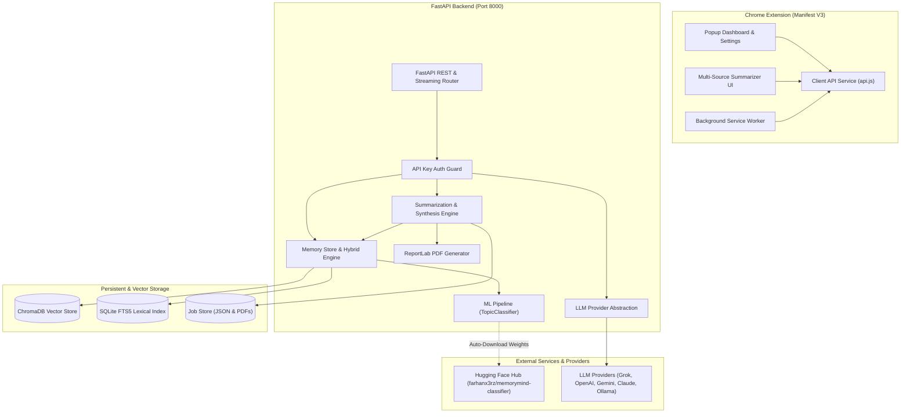
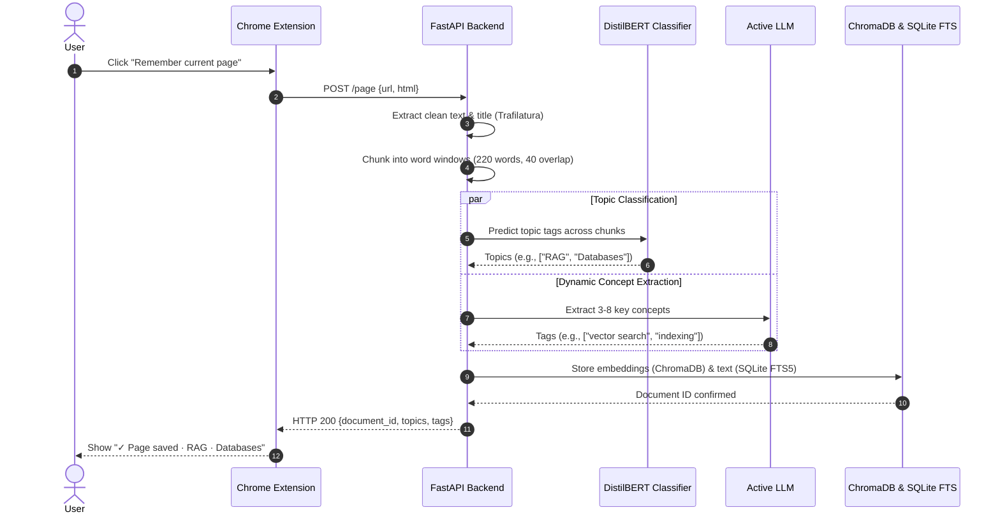
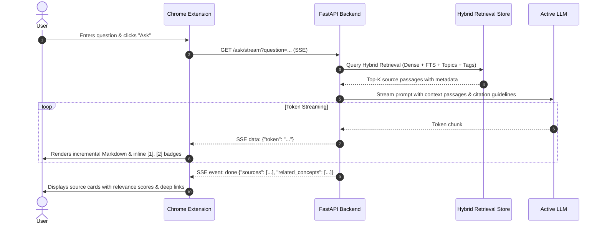

# MemoryMind Technical Architecture

MemoryMind is an intelligent personal memory and research synthesis platform. It bridges a modern **Manifest V3 Chrome Extension** with a **FastAPI asynchronous backend**, integrating hybrid vector-lexical retrieval, fine-tuned transformer topic classification, multi-source document ingestion, and multi-provider LLM synthesis.

---

## 1. High-Level Architecture

---

## 2. Component Breakdown

### 2.1 Chrome Extension (`extension/`)
- **Manifest V3 Architecture:** Uses a service worker (`background/service-worker.js`) for context menus and tab lifecycle monitoring.
- **Popup Dashboard (`popup/`):**
  - **First-Run Onboarding:** Intercepts unconfigured states and prompts the user to activate an AI provider.
  - **Interactive Question Answering:** Text input supporting instant streaming answers with inline clickable citation badges `[1]`, `[2]`.
  - **One-Click Page & Selection Memory:** Sends page URL or highlighted text to the backend for automatic extraction and tagging.
  - **AI Provider Management:** Dedicated Settings view to inspect active provider status (ACTIVE / NEEDS ATTENTION / NOT CONFIGURED), view masked credentials, live-test connections, or transactionally switch providers.
- **Unified Summarizer (`pdfsummarizer/` & `research/`):**
  - Multi-source research interface supporting mixed inputs (webpages, uploaded PDFs, active tab).
  - Configurable synthesis parameters (style, topic focus, length).
  - Background job polling with visual progress bar and downloadable PDF report generation.
- **API Service Layer (`api.js`):**
  - Manages `chrome.storage.local` persistence with graceful fallbacks.
  - Handles server health checking, streaming Server-Sent Events (SSE), and offline error recovery.

---

### 2.2 FastAPI Backend (`backend/app/`)
- **Main Application (`main.py`):**
  - Asynchronous lifespan preloading for ML models and ChromaDB clients.
  - Routes for `/health`, `/ask` (standard and SSE streaming), `/remember`, `/page`, `/jobs`, and `/provider/*`.
- **Security & Provider Management (`config.py`):**
  - Server-side credential isolation: Provider API keys are never stored in the extension or returned in plain text via API responses.
  - Key masking (`sk-••••••••abcd`) and transactional provider switching (test before commit).
- **Hybrid Retrieval Engine (`memory_store.py`):**
  - Combines four distinct signal channels into a unified relevance score:
    $$\text{Final Score} = 0.55 \cdot S_{\text{semantic}} + 0.20 \cdot S_{\text{keyword}} + 0.10 \cdot S_{\text{topic}} + 0.15 \cdot S_{\text{tag}}$$
  - **Semantic Dense Search:** ChromaDB cosine similarity using `sentence-transformers/all-MiniLM-L6-v2`.
  - **Lexical Keyword Search:** SQLite FTS5 full-text indexing for exact phrase matching.
  - **Topic Classification:** Fine-tuned DistilBERT multi-label taxonomy scoring.
  - **Concept Tags:** LLM-extracted dynamic tags for nuanced domain indexing.

---

### 2.3 Machine Learning Subsystem (`backend/ml/`)
- **Model:** Fine-tuned DistilBERT multi-label topic classifier trained across 17 technical domains (AI, RAG, Databases, Cloud, Mathematics, etc.).
- **Hugging Face Hub Integration (`hub.py`):**
  - Model weights (`model.safetensors`, 268 MB) are decoupled from the Git repository and hosted on [Hugging Face (`farhanx3rz/memorymind-classifier`)](https://huggingface.co/farhanx3rz/memorymind-classifier).
  - Uses `snapshot_download` to fetch artifacts into an isolated staging directory on demand.
  - Validates configuration, weights, and tokenizer files before promoting to the active model directory.
  - Supports configurable revisions (`HF_MODEL_REVISION`) and offline fallback.
- **Inference Pipeline (`classifier.py`):**
  - Efficient representative chunk evaluation: for long documents, samples head and distributed body chunks to prevent redundant inference while maintaining high classification accuracy.

---

### 2.4 Document Processing & Summarization (`backend/app/`)
- **Web Extraction (`webpage.py`):** Uses Trafilatura and BeautifulSoup to sanitize arbitrary webpage HTML, strip navigation boilerplate, and extract clean markdown content.
- **PDF Extraction (`pdf_handler.py`):** Uses `pypdf` to extract text from multi-page PDFs, mapping content to individual page numbers for citation accuracy.
- **Synthesis Engine (`synthesis.py`):** Formulates structured research summaries with citation verification.
- **ReportLab PDF Generator (`pdf_generator.py`):** Compiles multi-source research into branded, publication-ready PDF reports with headers, table of contents, summaries, and formal citation bibliographies.

---

## 3. Data Flow Workflows

### 3.1 Memory Capture & Indexing

---

### 3.2 Question Answering with Citations (Streaming RAG)

